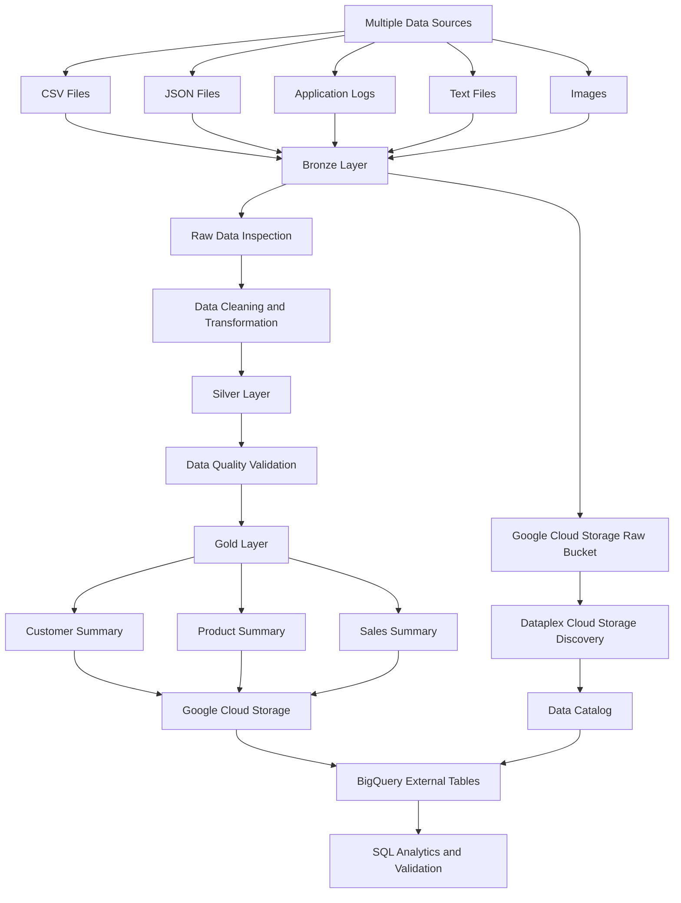
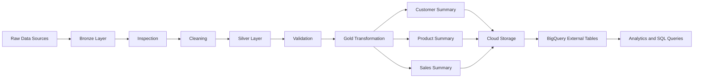
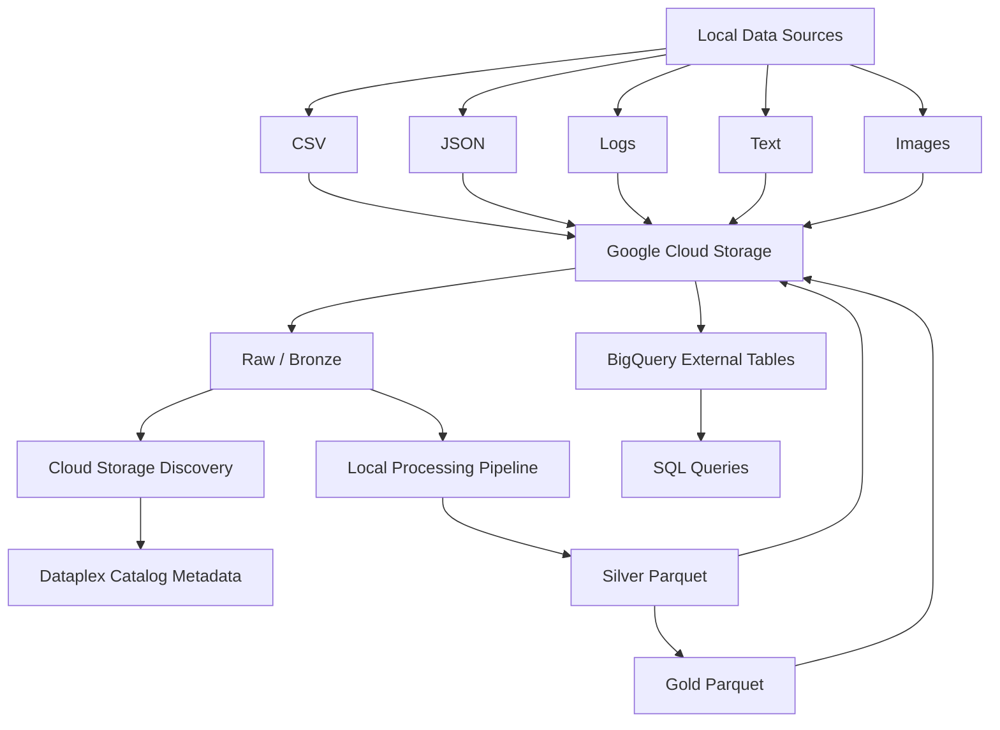
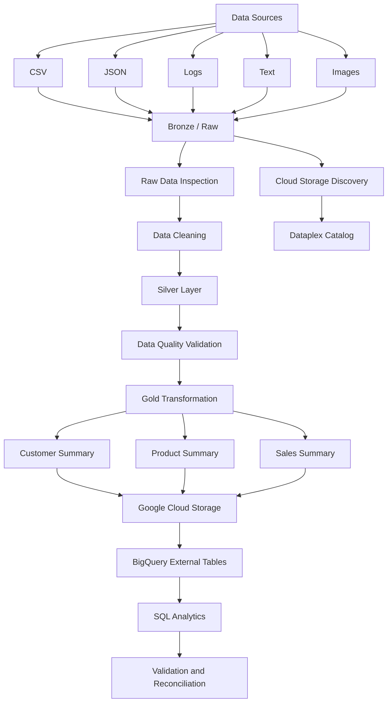

# Hands-on Data Lake Assignment

## 1. Project Overview

This project demonstrates the implementation of a practical **Data Lake architecture** using local data processing tools and Google Cloud Platform (GCP).

The objective was to understand how heterogeneous raw data can be collected, stored, inspected, cleaned, transformed, validated, and converted into analytics-ready datasets through a layered architecture.

The project follows the **Bronze → Silver → Gold** data-processing approach.

The implementation includes:

- Raw data generation and inspection
- Data Lake storage architecture
- Heterogeneous data handling
- Data catalog and discovery
- Data cleaning and transformation
- CSV vs. Parquet storage comparison
- Data quality validation
- Referential integrity validation
- Gold-layer analytical datasets
- Cloud Storage integration
- BigQuery external tables
- Analytical querying
- Data reconciliation
- Cloud resource cleanup

The project was implemented using Python for local processing and Google Cloud services for cloud storage, data discovery, and analytical querying.

---

## 2. Project Objectives

The main objectives of this assignment were:

1. Understand the concept and architecture of a Data Lake.
2. Understand how raw data is stored in its original form.
3. Work with multiple data formats.
4. Learn the Bronze, Silver, and Gold data-layer architecture.
5. Perform data cleaning and standardization.
6. Convert cleaned data into Parquet format.
7. Validate data quality and integrity.
8. Create analytical datasets.
9. Upload datasets to Google Cloud Storage.
10. Discover and catalog cloud data.
11. Query cloud data using BigQuery.
12. Understand the difference between Data Lakes and Data Warehouses.
13. Learn how to manage cloud resources and reduce unnecessary costs.

---

# 3. Technologies Used

| Technology                                           | Purpose                                                                 |
| ---------------------------------------------------- | ----------------------------------------------------------------------- |
| Python                                               | Data generation, inspection, processing, validation, and transformation |
| Pandas                                               | Data manipulation and analysis                                          |
| PyArrow                                              | Parquet processing and columnar storage support                         |
| Pillow                                               | Image file inspection                                                   |
| CSV                                                  | Raw tabular data storage                                                |
| JSON                                                 | Structured and nested data storage                                      |
| Text files                                           | Documentation and business information                                  |
| Log files                                            | Application event data                                                  |
| Parquet                                              | Optimized analytical storage format                                     |
| Google Cloud Storage                                 | Cloud Data Lake storage                                                 |
| Dataplex Universal Catalog / Cloud Storage Discovery | Data discovery and cataloging                                           |
| BigQuery                                             | Analytical querying of cloud datasets                                   |
| Google Cloud Shell                                   | Cloud-side commands and operations                                      |
| Git                                                  | Version control                                                         |
| GitHub                                               | Remote repository and project storage                                   |
| Visual Studio Code                                   | Local development environment                                           |

---

# 4. Important Concepts

## 4.1 Data Lake

A Data Lake is a centralized storage system that can store large amounts of data in its original or minimally processed form.

It can store:

- Structured data
- Semi-structured data
- Unstructured data
- Historical data
- Raw data
- Processed data

Unlike a traditional Data Warehouse, a Data Lake does not require every dataset to follow a rigid schema before storage.

Data can be stored first and processed later.

### Example

A Data Lake may store:

- Customer CSV files
- Order CSV files
- Product CSV files
- JSON event data
- Application logs
- Images
- Text documents

These files can later be processed according to analytical or business requirements.

---

## 4.2 Data Lake vs. Data Warehouse

### Data Lake

A Data Lake is primarily designed for flexible data storage.

It can store raw and processed data in different formats.

Characteristics:

- Flexible storage
- Supports structured, semi-structured, and unstructured data
- Stores raw data
- Schema can be applied during processing or querying
- Suitable for data engineering, machine learning, analytics, and exploration

### Data Warehouse

A Data Warehouse is primarily designed for structured analytical data.

Characteristics:

- Structured and organized data
- Defined schemas
- Business-oriented datasets
- Optimized analytical queries
- Aggregated and modeled data
- Suitable for reporting and business intelligence

### Comparison

| Feature         | Data Lake                               | Data Warehouse                            |
| --------------- | --------------------------------------- | ----------------------------------------- |
| Primary purpose | Store diverse data                      | Analyze structured business data          |
| Data format     | CSV, JSON, logs, images, Parquet, etc.  | Mostly structured tables                  |
| Data state      | Raw and processed data                  | Curated and modeled data                  |
| Schema          | Flexible                                | Generally predefined                      |
| Processing      | Data can be processed later             | Data is generally modeled before analysis |
| Storage         | File-based or object storage            | Warehouse-managed storage                 |
| Users           | Data engineers, analysts, scientists    | Analysts, BI users, business teams        |
| Flexibility     | High                                    | More structured                           |
| Typical use     | Data exploration, ingestion, processing | Reporting, dashboards, business analysis  |

---

# 5. Data Lake Architecture

The project follows a layered Data Lake architecture.

## 5.1 Bronze Layer

The Bronze layer stores the original/raw data.

The data is collected from different sources and stored without major transformations.

Purpose:

- Preserve original data
- Maintain source information
- Support future processing
- Allow reprocessing
- Maintain a historical/raw copy

In this project, the Bronze layer contained CSV, JSON, logs, text files, and an image.

---

## 5.2 Silver Layer

The Silver layer contains cleaned, standardized, validated, and structured data.

Processing performed:

- Data loading
- Schema validation
- Column standardization
- Duplicate checking
- Data cleaning
- Type conversion
- Date standardization
- Data validation
- Parquet conversion

The Silver layer contains cleaned customer, order, and product datasets.

---

## 5.3 Gold Layer

The Gold layer contains business-oriented and analytics-ready datasets.

It is designed to make analytical queries easier.

The Gold datasets were created by combining and aggregating Silver-layer data according to business requirements.

The Gold layer contains:

- Customer Summary
- Product Summary
- Sales Summary

---

# 6. Architecture Diagram



---

# 7. Project Folder Structure

The local project was organized into separate folders for configuration, raw data, processing layers, scripts, documentation, and reports.

```text
data-lake-assignment/
│
├── config/
│
├── data/
│   │
│   ├── raw/
│   │   ├── csv/
│   │   ├── json/
│   │   ├── logs/
│   │   ├── text/
│   │   └── images/
│   │
│   ├── silver/
│   │   ├── customers/
│   │   ├── orders/
│   │   └── products/
│   │
│   └── gold/
│       ├── customer_summary/
│       ├── product_summary/
│       └── sales_summary/
│
├── docs/
│
├── reports/
│
├── scripts/
│   ├── generate_raw_data.py
│   ├── inspect_raw_data.py
│   ├── validate_silver.py
│   ├── compare_storage.py
│   ├── validate_data_quality.py
│   └── validate_gold.py
│
├── src/
│   │
│   ├── catalog/
│   │
│   ├── ingestion/
│   │
│   └── processing/
│       ├── clean_data.py
│       └── build_gold.py
│
├── requirements.txt
├── .gitignore
└── README.md
```

---

# 8. Step-by-Step Implementation

# Step 1 — Environment Setup

## Objective

Prepare the local environment for Data Lake development and processing.

## Environment

- Operating System: Windows
- Development environment: Visual Studio Code
- Python: Python 3.x
- Project directory: `D:\data-lake-assignment`

## Project initialization

The project directory was created and opened in Visual Studio Code.

A Python virtual environment was created to isolate project dependencies.

### Commands

```powershell
cd D:\data-lake-assignment
```

Create a virtual environment:

```powershell
python -m venv .venv
```

Activate the virtual environment:

```powershell
.\.venv\Scripts\Activate.ps1
```

Install dependencies:

```powershell
pip install pandas pyarrow pillow
```

The dependencies were also documented in `requirements.txt`.

### Why a virtual environment?

A virtual environment keeps project-specific Python packages separate from the system Python installation.

Benefits:

- Dependency isolation
- Avoids package conflicts
- Easier project reproduction
- Cleaner development environment

---

# Step 2 — Generate Raw Data

## Objective

Create a sample dataset containing different data formats to simulate a real-world Data Lake environment.

The raw data was organized into different folders according to file type.

The raw layer was designed to represent data received from different sources.

## Raw Data Categories

### CSV

Structured tabular data.

Examples of entities represented:

- Customers
- Orders
- Products

### JSON

Semi-structured data.

JSON was used to represent:

- Customer events
- Product catalog information

### Logs

Application log information representing application activity and operational events.

### Text

Business information and data dictionary documentation.

### Images

An image file representing unstructured data.

## Folder organization

```text
data/raw/
│
├── csv/
├── json/
├── logs/
├── text/
└── images/
```

## Purpose

The purpose of this step was to understand that a Data Lake can contain different data formats without requiring every dataset to be converted into a database table immediately.

---

# Step 3 — Inspect Raw Data

## Objective

Understand the raw data before beginning transformations.

Raw data inspection helps identify:

- File formats
- Record counts
- Columns
- Data types
- Missing values
- Nested JSON structures
- Date ranges
- File sizes
- Image dimensions
- Potential data quality problems

## Inspection process

The inspection workflow examined the raw files and generated information about the datasets.

The inspection covered:

- CSV structure
- JSON structure
- Log records
- Text files
- Image metadata

## Why inspection is important

Data engineers should not begin transformation without understanding the incoming data.

Raw data inspection helps determine:

- Which columns exist
- Which fields are required
- Which fields need cleaning
- Which data types should be used
- Whether data contains missing or duplicate records
- How the data should be processed

---

# Step 4 — Create the Google Cloud Project

## Objective

Create a Google Cloud environment for cloud storage, data discovery, and analytical querying.

The GCP project used for this assignment was:

```text
Project ID:
data-lake-hands-on-515304
```

## Region

```text
asia-south1
```

The Mumbai region was selected to keep cloud resources geographically close to India.

## Services used

- Google Cloud Storage
- Dataplex Universal Catalog / Cloud Storage Discovery
- BigQuery
- Cloud Shell

---

# Step 5 — Create Google Cloud Storage Bucket

## Objective

Create cloud storage for the Data Lake.

The bucket created was:

```text
data-lake-hands-on-515304-raw
```

## Bucket configuration

| Configuration | Value                         |
| ------------- | ----------------------------- |
| Bucket name   | data-lake-hands-on-515304-raw |
| Region        | asia-south1                   |
| Storage class | Standard                      |
| Access        | Private                       |
| Purpose       | Data Lake storage             |

## Concept: Object Storage

Google Cloud Storage is an object-storage service.

Instead of storing data as traditional filesystem blocks, object storage stores objects inside buckets.

Each object has:

- Object data
- Object name
- Metadata
- Storage location

A bucket acts as a container for objects.

## Concept: Storage Prefixes

Cloud Storage does not require traditional folders.

Folder-like structures are generally represented using object-name prefixes.

For example:

```text
raw/csv/customers.csv
raw/json/customer_events.json
silver/customers/customers.parquet
gold/customer_summary/customer_summary.parquet
```

These prefixes help organize data logically.

---

# Step 6 — Upload Raw Data to Cloud Storage

## Objective

Upload the raw datasets into the cloud Data Lake.

The raw files were organized into the following logical structure:

```text
gs://data-lake-hands-on-515304-raw/

└── raw/
    ├── csv/
    ├── json/
    ├── logs/
    ├── text/
    └── images/
```

## Data Lake ingestion

The local raw files were uploaded into the GCS bucket.

The uploaded data included:

- CSV files
- JSON files
- Log files
- Text files
- Image files

## Cloud Storage command examples

List bucket objects:

```bash
gcloud storage ls gs://data-lake-hands-on-515304-raw/
```

List all objects recursively:

```bash
gcloud storage ls --recursive gs://data-lake-hands-on-515304-raw/
```

Check bucket size:

```bash
gcloud storage du -s gs://data-lake-hands-on-515304-raw/
```

## Result

The raw datasets were successfully uploaded to the cloud bucket.

This completed the cloud-based Bronze/raw storage stage.

---

# Step 7 — Data Discovery and Cataloging

## Objective

Discover the data stored in the Cloud Storage bucket and understand how metadata can be automatically collected.

## Concept: Data Discovery

Data Discovery is the process of scanning storage locations to identify datasets and understand their structure.

Discovery can help identify:

- Files
- Data formats
- Schemas
- Metadata
- Dataset structure
- Potential tables

## Concept: Data Catalog

A Data Catalog maintains metadata about datasets.

Metadata may include:

- Dataset name
- Table name
- Column names
- Data types
- Storage location
- Description
- Data source information

A catalog helps users discover and understand data without manually inspecting every file.

## Service used

Dataplex Universal Catalog / Cloud Storage Discovery was used for the discovery process.

## Discovery configuration

A discovery scan was configured.

| Setting     | Value                         |
| ----------- | ----------------------------- |
| Scan name   | Raw Data Lake Discovery       |
| Scan ID     | raw-data-lake-discovery       |
| Data source | Cloud Storage bucket          |
| Bucket      | data-lake-hands-on-515304-raw |
| Region      | asia-south1                   |
| Scope       | raw/\*\*                      |
| Scan type   | On-demand discovery           |

## IAM configuration

The discovery service required the appropriate service-agent permissions.

The required role was assigned to the Dataplex discovery service account.

The role used:

```text
roles/dataplex.discoveryPublishingServiceAgent
```

The service account was associated with the project-specific Dataplex service agent.

## Discovery execution

The scan was executed and completed successfully.

## Discovery results

| Metric            |                        Result |
| ----------------- | ----------------------------: |
| Files scanned     |                             9 |
| Data processed    |                      75.48 KB |
| Tables created    |                             1 |
| Published dataset | data_lake_hands_on_515304_raw |

## Important observation

The scan successfully examined the raw files, but only one table was published from the discovered data.

The published table represented the product CSV dataset.

This demonstrates that scanning a Data Lake does not necessarily mean every file type is automatically converted into a queryable table.

Different formats and file structures may require different discovery capabilities or custom processing.

---

# Step 8 — Verify the Catalog Dataset in BigQuery

## Objective

Verify that the discovered dataset was available in BigQuery.

The discovered dataset was:

```text
data_lake_hands_on_515304_raw
```

The discovered table was:

```text
raw_csv
```

## BigQuery verification

The table was opened in BigQuery and its schema was examined.

The discovered schema contained fields such as:

- Product ID
- Product name
- Category
- Price
- Stock quantity

## Query

```sql
SELECT *
FROM `data-lake-hands-on-515304.data_lake_hands_on_515304_raw.raw_csv`
LIMIT 10;
```

## Concept: BigQuery

BigQuery is a serverless analytical data warehouse.

It supports:

- SQL analytics
- Large-scale data processing
- Reporting
- Aggregation
- Data exploration

In this assignment, BigQuery was used to query data stored in Cloud Storage and verify discovered datasets.

---

# Step 9 — Build the Silver Layer

## Objective

Clean, standardize, validate, and convert raw structured datasets into a more reliable analytical format.

The Silver layer was created from the raw customer, order, and product datasets.

## Concept: Data Cleaning

Data cleaning is the process of identifying and correcting problems in data.

Common data cleaning activities include:

- Removing duplicate records
- Handling missing values
- Standardizing column names
- Converting data types
- Validating data
- Standardizing dates
- Correcting invalid values

## Transformations performed

### Customers

Customer data was processed to ensure:

- Required columns were present
- Customer IDs were valid
- Duplicate records were checked
- Column names were standardized
- Date fields were converted to appropriate types
- Data was stored in a standardized format

### Orders

Order data was processed to ensure:

- Required columns were present
- Order IDs were valid
- Customer references were checked
- Duplicate orders were checked
- Dates were standardized
- Order status values were retained and validated

### Products

Product data was processed to ensure:

- Product IDs were valid
- Required product fields were present
- Prices were valid
- Stock quantities were valid
- Duplicate product IDs were checked

---

# Step 10 — Convert Silver Data to Parquet

## Objective

Store cleaned data using Parquet, a columnar file format designed for analytical workloads.

## Concept: Parquet

Parquet is a columnar storage format.

Unlike traditional row-oriented formats, Parquet stores data organized by columns.

## Row-based storage

In row-based storage, the values of a record are stored together.

This is useful when retrieving complete records.

## Column-based storage

In column-based storage, values from the same column are stored together.

This is useful when analytical queries read only a few columns from a large dataset.

## Advantages of Parquet

- Columnar storage
- Schema preservation
- Compression support
- Efficient analytical queries
- Column pruning
- Reduced data scanning
- Support for analytical processing engines

## Silver output structure

```text
data/silver/

├── customers/
│   └── customers.parquet
│
├── orders/
│   └── orders.parquet
│
└── products/
    └── products.parquet
```

## Result

The cleaned datasets were successfully converted into Parquet files.

---

# Step 11 — Validate Silver Data

## Objective

Validate the Silver datasets after cleaning and conversion.

## Validation categories

### Record count validation

Ensure records were not unexpectedly lost during transformation.

### Schema validation

Ensure expected columns and data types were present.

### Null validation

Check for missing values.

### Duplicate validation

Check duplicate records and duplicate identifiers.

### File validation

Ensure Parquet files were readable.

## Silver validation results

| Dataset   | Records | Columns | Parquet Size | Nulls | Duplicates |
| --------- | ------: | ------: | -----------: | ----: | ---------: |
| Customers |     100 |       6 |      6.51 KB |     0 |          0 |
| Orders    |     250 |       5 |      7.17 KB |     0 |          0 |
| Products  |      30 |       5 |      4.30 KB |     0 |          0 |
| **Total** | **380** |  **16** | **17.98 KB** | **0** |      **0** |

## Result

All Silver datasets were readable and passed the initial validation checks.

No records were removed during the cleaning process because the generated source data was already clean.

---

# Step 12 — CSV vs. Parquet Storage Comparison

## Objective

Compare the storage size of CSV and Parquet datasets.

This experiment was performed to understand the benefits and limitations of Parquet.

## Concept: Storage Format Comparison

Different file formats have different storage characteristics.

CSV is a text-based format.

Parquet is a columnar binary format with metadata and encoding support.

Parquet can provide better compression and analytical performance, but small datasets may not always become smaller.

## Results

| Dataset   | CSV Size | Parquet Size | Result                 |
| --------- | -------: | -----------: | ---------------------- |
| Customers |  6.30 KB |      6.51 KB | Parquet 3.41% larger   |
| Orders    |  9.61 KB |      7.17 KB | Parquet 25.38% smaller |
| Products  |  1.37 KB |      4.30 KB | Parquet 214.36% larger |

## Total size comparison

| Layer          | Total Size |
| -------------- | ---------: |
| Bronze CSV     |   17.27 KB |
| Silver Parquet |   17.98 KB |

Overall, Silver Parquet storage was approximately 4.10% larger than the original CSV files.

## Important learning

Parquet does not guarantee smaller files for every dataset.

Small datasets may experience additional metadata overhead.

However, Parquet still provides important benefits:

- Columnar storage
- Schema information
- Efficient analytical reads
- Column pruning
- Compression options
- Better support for large analytical workloads

The storage-size comparison should therefore not be used as the only measure of Parquet's performance.

---

# Step 13 — Data Quality Validation

## Objective

Validate the quality and reliability of the Silver datasets.

Data quality checks were performed on customers, orders, and products.

## Customer validation

Checks included:

- Duplicate customer IDs
- Missing customer IDs
- Invalid customer IDs
- Invalid emails
- Missing signup dates
- Invalid signup dates
- Future signup dates

## Order validation

Checks included:

- Duplicate order IDs
- Missing order IDs
- Invalid order IDs
- Invalid customer IDs
- Missing customer references
- Invalid order dates
- Missing order dates
- Future order dates
- Missing order statuses
- Missing payment methods

## Product validation

Checks included:

- Duplicate product IDs
- Missing product IDs
- Invalid product IDs
- Negative prices
- Invalid prices
- Negative stock quantities
- Invalid stock quantities
- Missing product names
- Missing categories

## Results

### Customers

All customer data quality checks passed.

### Orders

All order data quality checks passed.

### Products

All product data quality checks passed.

## Overall result

```text
Data quality issues: 0
Validation status: PASS
```

## Concept: Referential Integrity

Referential integrity ensures that references between datasets are valid.

For example:

An order contains a customer ID.

That customer ID should exist in the customer dataset.

A missing customer reference can cause incorrect reporting or broken relationships.

The validation process checked whether the customer references in the orders dataset matched existing customers.

---

# Step 14 — Build the Gold Layer

## Objective

Transform Silver data into business-oriented datasets that are easier to analyze.

The Gold layer was designed to provide analytical summaries.

## Gold datasets

### 1. Customer Summary

**Grain:** One row per customer.

The customer summary combines customer information with order-related metrics.

Fields include:

- Customer ID
- Customer name
- Email
- City
- Region
- Signup date
- Total orders
- Delivered orders
- Cancelled orders
- Returned orders
- Shipped orders
- Processing orders
- Last order date
- Customer order status

## Customer classification

### No Orders

Customers with no orders.

### Delivered Customer

Customers with at least one delivered order.

### Active Customer

Customers who have orders but no delivered order under the implemented classification logic.

This classification is specific to the assignment and should not be interpreted as a universal business definition.

---

### 2. Product Summary

**Grain:** One row per product.

The product summary includes the original product attributes and additional inventory-related metrics.

Fields include:

- Product ID
- Product name
- Category
- Price
- Stock quantity
- Inventory value
- Stock status

## Inventory value

The inventory value is calculated as:

```text
Inventory Value = Product Price × Stock Quantity
```

This represents an estimated inventory value.

It is not sales revenue.

## Stock classification

### Out of Stock

Stock quantity is zero.

### Low Stock

Stock quantity is between 1 and 10.

### In Stock

Stock quantity is greater than 10.

---

### 3. Sales Summary

**Grain:** One row per order date and order status.

The Sales Summary provides daily order-status analytics.

Fields include:

- Order date
- Order status
- Total orders
- Unique customers
- Daily total orders
- Percentage of daily orders

## Daily order percentage

The percentage represents the share of orders for a specific status compared with the total orders for that date.

Conceptually:

```text
Status Percentage =
Orders for Status on Date
÷
Total Orders on Date
× 100
```

## Important limitation

The source order dataset did not contain product IDs or order amounts.

Therefore, the Sales Summary does not calculate:

- Revenue
- Average order value
- Profit
- Product-level sales
- Customer monetary value

These metrics would require additional data.

---

# Step 15 — Gold Layer Transformation

## Objective

Create the analytical datasets from Silver data.

The transformation process loaded the Silver customer, order, and product datasets and generated the Gold summaries.

## Outputs

```text
data/gold/

├── customer_summary/
│   └── customer_summary.parquet
│
├── product_summary/
│   └── product_summary.parquet
│
└── sales_summary/
    └── sales_summary.parquet
```

## Transformation results

| Dataset          | Records |
| ---------------- | ------: |
| Customer Summary |     100 |
| Product Summary  |      30 |
| Sales Summary    |     239 |

## Customer classification results

| Classification     | Customers |
| ------------------ | --------: |
| Active Customer    |        62 |
| Delivered Customer |        33 |
| No Orders          |         5 |
| **Total**          |   **100** |

## Product stock classification results

| Stock Status | Products |
| ------------ | -------: |
| In Stock     |       28 |
| Low Stock    |        2 |
| Out of Stock |        0 |
| **Total**    |   **30** |

## Sales status totals

| Order Status |  Orders |
| ------------ | ------: |
| Cancelled    |      64 |
| Delivered    |      46 |
| Processing   |      55 |
| Returned     |      48 |
| Shipped      |      37 |
| **Total**    | **250** |

---

# Step 16 — Validate the Gold Layer

## Objective

Verify that the Gold datasets were generated correctly and that the analytical metrics were consistent with the underlying Silver data.

## Validation checks

The Gold validation process included:

- Record counts
- Unique customer IDs
- Unique product IDs
- Null handling
- Customer classifications
- Customer order counts
- Order count reconciliation
- Product inventory value calculations
- Stock classification
- Product stock reconciliation
- Sales Summary grain validation
- Daily total orders
- Order-status percentages
- Order-status totals

## Gold validation results

| Metric            | Result |
| ----------------- | -----: |
| Validation checks |     21 |
| Passed            |     21 |
| Failed            |      0 |
| Validation status |   PASS |

## Important validation rule

Customers with no orders are expected to have a null `last_order_date`.

The validation logic was adjusted to allow this condition.

Null dates were considered valid for customers whose order count was zero.

---

# Step 17 — Upload Silver Data to Google Cloud Storage

## Objective

Upload the cleaned Silver datasets to the cloud Data Lake.

The Silver datasets were uploaded to the GCS bucket.

## Cloud Storage structure

```text
gs://data-lake-hands-on-515304-raw/

└── silver/
    ├── customers/
    │   └── customers.parquet
    │
    ├── orders/
    │   └── orders.parquet
    │
    └── products/
        └── products.parquet
```

## Upload process

The local Parquet files were uploaded using Google Cloud Shell and Cloud Storage commands.

## Verification

The uploaded objects were verified using recursive listing.

The Silver datasets were confirmed to exist in the bucket.

---

# Step 18 — Upload Gold Data to Google Cloud Storage

## Objective

Upload the Gold analytical datasets to Cloud Storage.

The Gold datasets were packaged locally and transferred to Cloud Shell before being uploaded to GCS.

## Local package

The Gold datasets were packaged into:

```text
gold_datasets.zip
```

## Cloud Shell process

The ZIP file was uploaded to Cloud Shell.

The package was extracted into a temporary upload directory.

The extracted Gold datasets were uploaded to the GCS bucket.

## Cloud Storage structure

```text
gs://data-lake-hands-on-515304-raw/

└── gold/
    ├── customer_summary/
    │   └── customer_summary.parquet
    │
    ├── product_summary/
    │   └── product_summary.parquet
    │
    └── sales_summary/
        └── sales_summary.parquet
```

## Verification

The Gold objects were verified using recursive listing and storage-size commands.

---

# Step 19 — Create BigQuery External Tables

## Objective

Make the Gold Parquet datasets queryable through BigQuery without importing the data into BigQuery-managed storage.

## Concept: External Table

An external table allows BigQuery to query data stored outside of BigQuery's managed table storage.

In this assignment, the source data was stored in Google Cloud Storage.

The external table definitions were created in BigQuery and referenced the Parquet files in the GCS bucket.

## Concept: External Data

External tables allow users to query supported files using SQL while the underlying data remains in its original storage location.

## BigQuery dataset

The dataset created was:

```text
gold_layer
```

## Tables created

| Table            | Purpose                       | Records |
| ---------------- | ----------------------------- | ------: |
| customer_summary | Customer analytical summary   |     100 |
| product_summary  | Product and inventory summary |      30 |
| sales_summary    | Daily order-status summary    |     239 |

## External table architecture

```text
Google Cloud Storage
        |
        |
    Parquet Files
        |
        |
 BigQuery External Tables
        |
        |
       SQL
```

## Important concept

Creating an external table does not necessarily copy the underlying files into BigQuery-managed storage.

The external table provides a SQL-accessible representation of the data.

---

# Step 20 — Query Gold Data in BigQuery

## Objective

Verify that the Gold datasets were queryable and contained the expected information.

The external tables were opened in BigQuery and queried.

## Customer Summary

The Customer Summary table was verified.

The results confirmed:

- Customer records were available
- Customer order metrics were present
- Customers without orders were correctly represented
- No-order customers had zero total orders
- No-order customers had a null last order date
- Customer classifications were present

## Product Summary

The Product Summary table was verified.

The results confirmed:

- Product information was available
- Inventory values were calculated
- Stock classifications were available

## Sales Summary

The Sales Summary table was verified.

The results confirmed:

- Dates were represented
- Order statuses were aggregated
- Daily order totals were available
- Order percentages were calculated

---

# Step 21 — Final Cloud Data Reconciliation

## Objective

Verify that the cloud datasets matched the expected totals from the local Gold layer.

## Reconciliation results

| Dataset          | Records | Reconciliation              |
| ---------------- | ------: | --------------------------- |
| Customer Summary |     100 | Total customer orders = 250 |
| Product Summary  |      30 | Product dataset verified    |
| Sales Summary    |     239 | Total orders = 250          |

## Reconciliation observations

The Customer Summary contained 100 records.

The customer order metrics reconciled to 250 total orders.

The Product Summary contained 30 records.

The Sales Summary contained 239 aggregated records.

The Sales Summary aggregation reconciled to 250 total orders.

## Result

The Gold datasets were successfully uploaded, queried, and reconciled in BigQuery.

---

# 12. Data Processing Architecture

## Raw-to-Gold Flow



---

# 13. Cloud Data Lake Architecture



---

# 14. Commands Used

This section documents the major commands used during the assignment.

The commands are provided for documentation and reproducibility.

## 14.1 Local environment

Navigate to the project:

```powershell
cd D:\data-lake-assignment
```

Create virtual environment:

```powershell
python -m venv .venv
```

Activate:

```powershell
.\.venv\Scripts\Activate.ps1
```

Install dependencies:

```powershell
pip install pandas pyarrow pillow
```

---

## 14.2 Generate raw data

```powershell
python scripts/generate_raw_data.py
```

---

## 14.3 Inspect raw data

```powershell
python scripts/inspect_raw_data.py
```

---

## 14.4 Clean and create Silver datasets

```powershell
python -m src.processing.clean_data
```

---

## 14.5 Validate Silver datasets

```powershell
python scripts/validate_silver.py
```

---

## 14.6 Compare CSV and Parquet storage

```powershell
python scripts/compare_storage.py
```

---

## 14.7 Validate Silver data quality

```powershell
python scripts/validate_data_quality.py
```

---

## 14.8 Build Gold datasets

```powershell
python -m src.processing.build_gold
```

---

## 14.9 Validate Gold datasets

```powershell
python scripts/validate_gold.py
```

---

# 15. Google Cloud Commands

## 15.1 Verify the active project

```bash
gcloud config get-value project
```

Set the project if required:

```bash
gcloud config set project data-lake-hands-on-515304
```

---

## 15.2 List Cloud Storage objects

```bash
gcloud storage ls gs://data-lake-hands-on-515304-raw/
```

---

## 15.3 Recursive listing

```bash
gcloud storage ls --recursive gs://data-lake-hands-on-515304-raw/
```

---

## 15.4 Check bucket storage size

```bash
gcloud storage du -s gs://data-lake-hands-on-515304-raw/
```

---

## 15.5 Upload files

The general upload pattern used was:

```bash
gcloud storage cp <local-file> gs://<bucket>/<destination-path>
```

---

## 15.6 Upload directories

The general directory-upload pattern:

```bash
gcloud storage cp --recursive <local-directory> gs://<bucket>/<destination-prefix>
```

---

# 16. BigQuery Concepts Learned

## Dataset

A BigQuery dataset is a logical container for tables and other BigQuery resources.

The Gold dataset used in this assignment was:

```text
gold_layer
```

## Table

A table contains data organized into columns and rows.

## External Table

An external table references data stored outside BigQuery's managed storage.

## SQL Analytics

SQL can be used to:

- Filter records
- Aggregate metrics
- Group data
- Count records
- Calculate percentages
- Reconcile totals
- Validate datasets

## Querying Parquet

BigQuery supports querying Parquet files through external table definitions.

This allows analytics to be performed directly against files stored in Cloud Storage.

---

# 17. Final Data Lake Results

## Raw Layer

The Raw/Bronze layer contained the original heterogeneous datasets.

The files included:

- CSV
- JSON
- Application logs
- Text
- Images

## Silver Layer

| Dataset   | Records | Status    |
| --------- | ------: | --------- |
| Customers |     100 | Validated |
| Orders    |     250 | Validated |
| Products  |      30 | Validated |

Total Silver records:

```text
380
```

## Gold Layer

| Dataset          | Records |
| ---------------- | ------: |
| Customer Summary |     100 |
| Product Summary  |      30 |
| Sales Summary    |     239 |

---

# 18. Validation Summary

## Silver Validation

| Validation              | Result |
| ----------------------- | ------ |
| Dataset readability     | PASS   |
| Schema validation       | PASS   |
| Null validation         | PASS   |
| Duplicate validation    | PASS   |
| Record count validation | PASS   |

## Data Quality Validation

| Dataset   | Status |
| --------- | ------ |
| Customers | PASS   |
| Orders    | PASS   |
| Products  | PASS   |

Total identified data quality issues:

```text
0
```

## Gold Validation

| Metric                  | Result |
| ----------------------- | -----: |
| Total validation checks |     21 |
| Passed checks           |     21 |
| Failed checks           |      0 |

## Cloud Validation

| Dataset                  | Status   |
| ------------------------ | -------- |
| Customer Summary         | Verified |
| Product Summary          | Verified |
| Sales Summary            | Verified |
| BigQuery external tables | Verified |
| Order reconciliation     | PASS     |

---

# 19. Important Limitations

The assignment successfully demonstrated a basic Data Lake workflow, but it also has some limitations.

## 19.1 Small datasets

The generated datasets were relatively small.

The assignment focused on understanding architecture and processing rather than large-scale performance.

## 19.2 No automated production ingestion

The ingestion process was implemented for the hands-on assignment.

A production Data Lake would generally require scheduled or event-driven ingestion pipelines.

## 19.3 Limited discovery coverage

Cloud Storage Discovery scanned the raw files but published only one table.

Additional processing or discovery configuration may be required for different formats.

## 19.4 Limited sales information

The order dataset did not contain monetary values or product-level references.

Therefore, the Gold Sales Summary did not calculate:

- Revenue
- Profit
- Average order value
- Product-level sales

## 19.5 No orchestration

The workflow was manually executed step-by-step.

A production implementation would generally use orchestration tools to coordinate ingestion, transformation, validation, and publishing.

## 19.6 No automated monitoring

The assignment did not implement production monitoring or alerting.

A production system would generally monitor:

- Pipeline failures
- Data freshness
- Data quality
- Processing duration
- Storage growth
- Cost

## 19.7 No production security implementation

The project used private Cloud Storage resources, but it did not implement a complete production governance model.

Production systems would generally require:

- Detailed IAM policies
- Access controls
- Data classification
- Encryption policies
- Audit logging
- Retention policies

---

# 20. Cloud Cleanup and Cost Protection

## Objective

After completing the assignment, cloud resources were cleaned up to reduce the possibility of unnecessary billing.

## Cleanup performed

### BigQuery

The Gold dataset was deleted.

Dataset removed:

```text
gold_layer
```

This removed the BigQuery external table definitions created for the Gold datasets.

The underlying GCS data was not deleted by deleting the BigQuery dataset.

### Google Cloud Storage

The Data Lake bucket was deleted.

Bucket:

```text
data-lake-hands-on-515304-raw
```

This removed the cloud storage location used for the assignment, subject to any applicable retention or soft-delete policies.

### Billing

Billing was disabled for the project.

Project:

```text
data-lake-hands-on-515304
```

## Important billing notes

Disabling billing for a project helps prevent future billable usage.

However:

- Charges already incurred may still appear.
- Billing reports can be delayed.
- Soft Delete or retention policies may affect storage deletion.
- Disabling billing does not necessarily erase previously incurred charges.
- The billing account itself should not be closed unless all other projects and account-level consequences have been considered.

---

# 21. What I Learned

Through this assignment, I learned:

## Data Lake fundamentals

- What a Data Lake is
- How Data Lakes differ from Data Warehouses
- How raw and processed data can coexist
- How heterogeneous data can be stored

## Data formats

- CSV
- JSON
- Logs
- Text
- Images
- Parquet

## Data engineering workflow

- Data ingestion
- Raw data inspection
- Data cleaning
- Schema validation
- Data transformation
- Data quality testing
- Referential integrity validation
- Data aggregation

## Data architecture

- Bronze layer
- Silver layer
- Gold layer
- Layered data architecture

## Storage concepts

- Object storage
- Cloud Storage buckets
- Object prefixes
- Storage formats
- Columnar storage
- Parquet

## Cloud concepts

- Google Cloud projects
- Google Cloud Storage
- Cloud Shell
- Dataplex Discovery
- Data Catalog
- BigQuery
- External tables
- Cloud resource cleanup

## Analytical concepts

- Dataset grain
- Aggregation
- Customer metrics
- Inventory metrics
- Order status metrics
- Reconciliation
- Data validation

---

# 22. Final Project Summary

This hands-on assignment demonstrated the end-to-end implementation of a basic Data Lake.

The project began by preparing the local environment and generating heterogeneous raw datasets.

The raw data was inspected and organized into the Bronze layer.

The structured customer, order, and product datasets were cleaned, validated, and converted into Parquet format to create the Silver layer.

The Silver datasets were validated for schema, record counts, nulls, duplicates, data quality, and referential integrity.

The CSV and Parquet storage formats were compared to understand their storage characteristics and analytical advantages.

The Gold layer was then created to provide business-oriented analytical datasets:

- Customer Summary
- Product Summary
- Sales Summary

The Gold datasets were validated through 21 checks, all of which passed.

The Silver and Gold datasets were uploaded to Google Cloud Storage.

Dataplex Cloud Storage Discovery was used to scan the raw Data Lake and publish discovered metadata.

BigQuery external tables were created for the Gold datasets, allowing SQL-based analytical queries to be performed directly against Parquet files stored in Cloud Storage.

Finally, the cloud resources used for the assignment were cleaned up to help protect the remaining Google Cloud credits.

---

# 23. Final Architecture



---

# 24. Conclusion

The assignment provided practical experience with the fundamental concepts of Data Lake architecture and data engineering.

The complete workflow demonstrated how raw data can be ingested, stored, discovered, cleaned, transformed, validated, and prepared for analytical use.

The Bronze, Silver, and Gold architecture helped separate raw data, cleaned data, and business-oriented datasets.

Parquet was introduced as a columnar analytical storage format.

Data quality and validation ensured that the transformed datasets were reliable.

Google Cloud Storage provided cloud object storage, Dataplex Discovery demonstrated metadata discovery, and BigQuery enabled analytical SQL queries through external tables.

The project also demonstrated the importance of cloud resource management and cost awareness by cleaning up the resources after the assignment was completed.

**Overall, the assignment successfully demonstrated a complete foundational Data Lake workflow from raw data ingestion to validated analytical datasets and cloud-based querying.**
